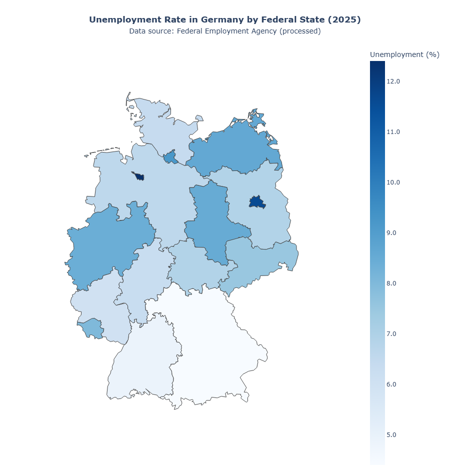

# German Unemployment Trends (1991–2025)

Has Eastern Germany closed the unemployment gap with the West, and is "the poor East" still the right picture today? This project tells a data-driven story of the German labour market across 35 years of federal state data.

## Highlights

- **Data**: Destatis Genesis-Online table **13211-0007**: registered unemployment as a percentage of the civilian labour force, 16 federal states, annual averages 1991–2025
- **Custom parser**: the raw CSV has state names as block headers, estimate flags and German number formats, so it is parsed line by line into a tidy table (Year, State, Rate, Region: East / West / Berlin)
- **East–West convergence**: the gap (East minus West average) grows through the 1990s, peaks at **10.2 percentage points in 2004** and falls to **0.4 points in 2025**
- **Hartz IV marker**: the 2005 reform (merger of unemployment and social assistance) is marked in the time-series charts. It causes a statistical break, and the strongest, most sustained decline in all regions starts after it.
- **2025 state map**: interactive Plotly choropleth of unemployment by federal state, plus a ranking against the national average
- **New hotspots**: in 2025 the highest rates are in **Bremen (12.4%)** and **Berlin (11.6%)**, not in an Eastern territorial state

## Results



| Finding | Value |
|---|---|
| East–West gap, 1991 | 3.5 pp |
| East–West gap, peak (2004) | 10.2 pp |
| East–West gap, 2025 | 0.4 pp |
| National average of state rates, 2025 | 7.66% |
| Lowest rate, 2025 | Bayern 4.4%, Baden-Württemberg 4.9% |
| Highest rate, 2025 | Bremen 12.4%, Berlin 11.6%, Hamburg 9.2% |
| Largest improvement 1991 to 2025 | Mecklenburg-Vorpommern -3.9 pp, Brandenburg -3.4 pp, Thüringen -3.3 pp |
| Largest increase 1991 to 2025 | Bremen +1.7 pp, Hessen +1.2 pp, Baden-Württemberg +1.2 pp |

The data supports the catch-up story: the East started far higher, improved the most, and is now close to the West. In 2025 unemployment is a mix of local problems, especially in city-states, rather than a simple East vs. West divide.

## Project structure

| File | Description |
|---|---|
| `data_process.ipynb` | Parses and cleans the raw Destatis CSV, adds the Region column, writes `german_unemployment_data.csv` |
| `main.ipynb` | Visual story: convergence line chart, 2025 state map, 2025 ranking, change since 1991, East–West gap |
| `13211-0007_en.csv` | Raw export from Destatis Genesis-Online |
| `german_unemployment_data.csv` | Cleaned dataset (output of `data_process.ipynb`) |
| `4_niedrig.geo.json` | GeoJSON of the German federal states, used for the map |
| `images/unemployment_map_2025.png` | Static image of the 2025 state map |
| `requirements.txt` | Python dependencies |

## Data source

Federal Statistical Office of Germany (Destatis) / Federal Employment Agency (BA), [Genesis-Online table 13211-0007](https://www-genesis.destatis.de/datenbank/online/statistic/13211/table/13211-0007): *Registered unemployed, unemployment as a percentage of the civilian labour force, registered vacancies: Länder, years.*

## How to run

```bash
pip install -r requirements.txt
jupyter notebook data_process.ipynb   # optional: rebuilds german_unemployment_data.csv
jupyter notebook main.ipynb
```

Paths are resolved relative to the notebook folder.

## Limitations and next steps

- The Hartz IV reform in 2005 is a methodological break, so values before and after 2005 are not fully comparable.
- 2025 values are the latest figures in the source file (generated in January 2026) and may still be revised.
- Regional averages are simple means of state rates, not weighted by labour force size.
- The interactive Plotly map does not render in GitHub's notebook preview, so a static image is included below it. Run the notebook locally for the interactive version.
- Next steps: district-level (Kreis) data, weighting by labour force, and adding vacancies to look at labour shortages.

**Author:** Mehdi Gurbanzade · M.Sc. Data Science
